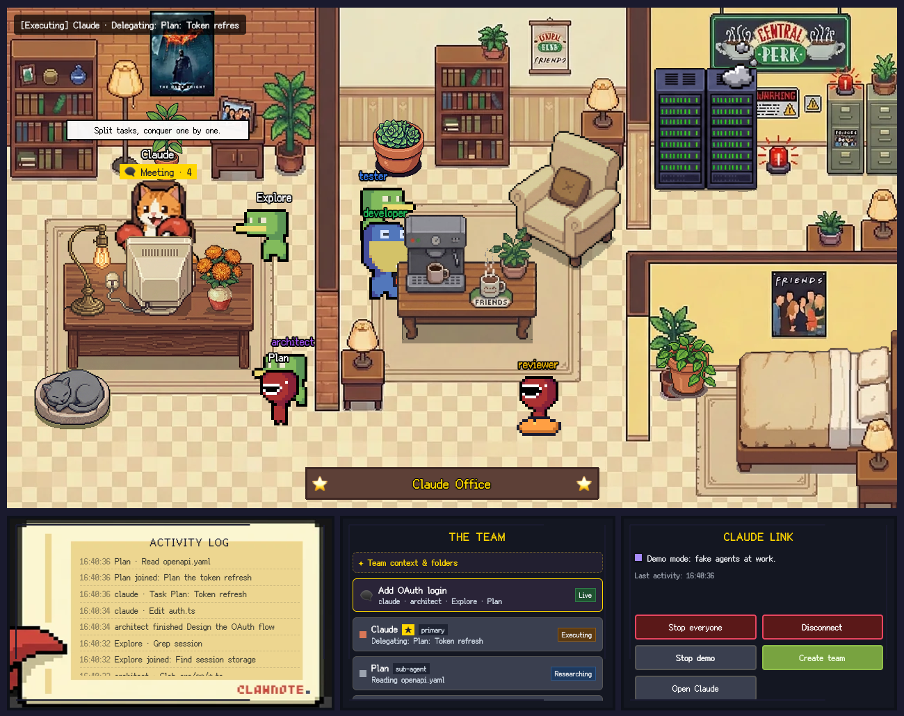
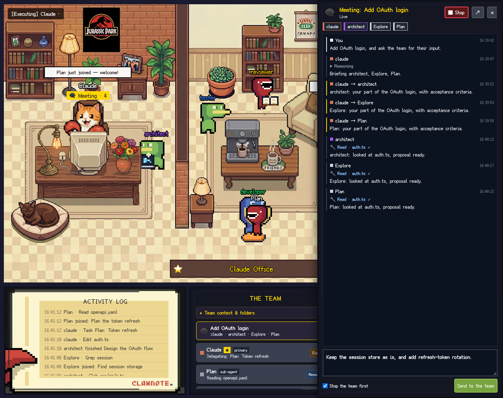
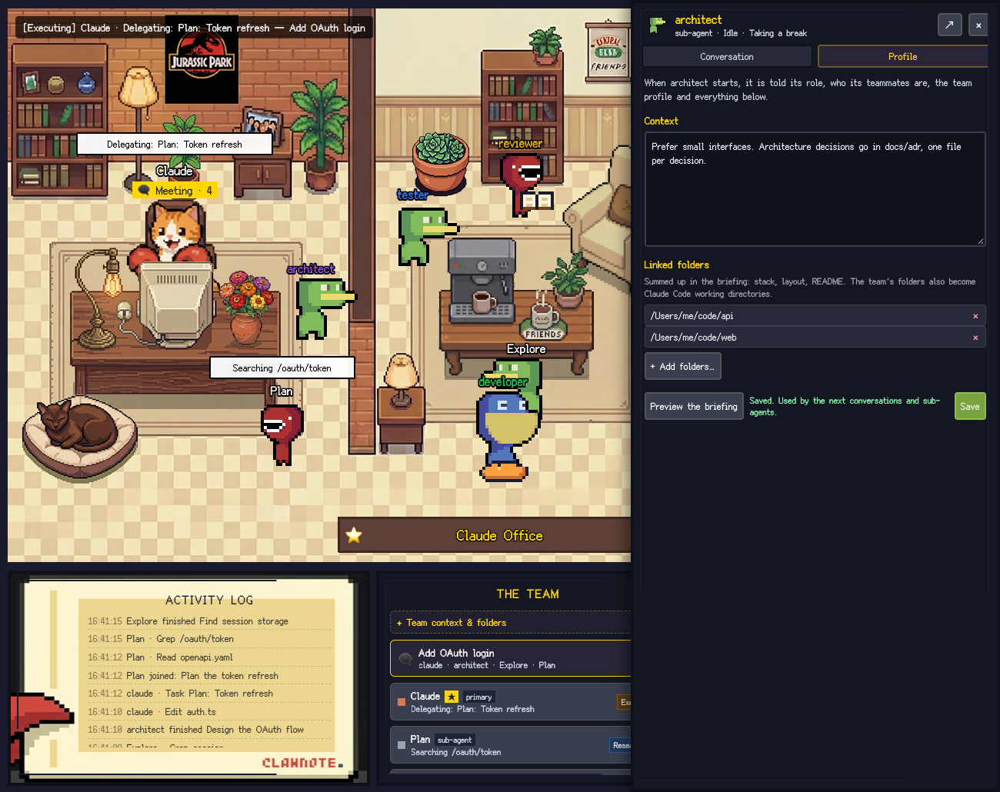

# Star UI for Claude Code

**A pixel-art office for your Claude Code agents.** Watch Claude and its sub-agents work in real time inside VS Code, follow their meetings, and brief your whole team.



Claude Code already works as a team: the main conversation plans and delegates, and sub-agents (Explore, Plan, general-purpose and your own) take their part. But all of that happens in text. Star UI turns it into a little office, forked from [Star-Office-UI](https://github.com/ringhyacinth/Star-Office-UI): every agent is a character that walks to the room matching what it does. Working agents gather in the office around Claude's desk, with a laptop, a terminal or a book; idle ones take a break in the lounge; an agent in trouble scratches its head in the server room; one waiting for the API naps in the bedroom.

## Features

- **One character per agent.** Claude's main conversation is the star at the desk; Claude Code's built-in sub-agents and your own sub-agents (`~/.claude/agents`, `.claude/agents`) all get a seat. Several sessions of the same agent show up as `Explore ×3`.
- **Live activity from Claude Code.** Tool calls, delegation, approvals, context compaction and errors are mapped to rooms and animations (see the tables below). Characters walk around walls and furniture.
- **Meetings you can follow.** When Claude delegates, the sub-agents walk to its desk and a *Meeting* marker appears. Click it, or the meeting in the team list, to read the whole thread: your request, the brief Claude sends to each sub-agent, their reasoning, the tools they run and their answers, updated live. Finished meetings move to *Past meetings*.
- **Chat with any agent.** Click a character to read its conversation next to the office, with its reasoning and tool calls, and to send it a message: Star UI opens Claude Code with your message ready to send.
- **Stop buttons.** Stop one agent (and the sub-agents it started), a whole meeting, or everyone: Claude Code stops at its next step.
- **"Needs you" alerts.** When an agent waits for your approval, it shows a `!` and the status bar turns orange.
- **Agents that know their team.** When a session or a sub-agent starts, it is told its role, who its teammates are and what each of them does.
- **Profiles: context and linked folders.** Give the whole team, or one agent, a context of its own (stack, conventions, links) and folders it should know about, like other repositories. The team's folders become Claude Code working directories.
- **A virtual team in one command.** *Star UI: Create a Virtual Team of Agents* writes ready-made Claude Code sub-agents with detailed role prompts that report back in a common format. Two presets: a general **Software team**, and a **Kubernetes & Go** team for operators and cloud services.
- **★ Claude Office in the activity bar**, activity log, team list, status bar item and demo mode, in English or French. The office fits the space it has: side by side in a short panel, one tab per panel in a narrow one, with no page scroll.
- **Your plan, your models.** Star UI never talks to a model: Claude Code runs the agents, with your own subscription or API key.



## Getting started

1. Install **Claude Code** in VS Code and sign in as usual.
2. Install **Star UI for Claude Code**. The office opens in an editor tab the first time and, when Claude Code is installed, a notification offers to connect it.
3. Click **Connect** (or **Connect Claude** in the office, or run *Star UI: Connect to Claude Code*).
4. Start a new Claude Code conversation: it reports to the office. Open the office any time with the **★ Claude Office** icon in the activity bar or the status bar item. It also lives in the bottom panel, next to the terminal.

No Claude Code at hand? Run *Star UI: Toggle Demo Mode* to watch fake agents at work.

## How it works

```
Claude Code (VS Code extension or terminal)
  └─ hooks in ~/.claude/settings.json ── run star-ui-claude-code-hook.cjs on each event
                        │  trimmed event (session, agent, tool name, short hint)
                        ▼
                  127.0.0.1 bridge (random port + token)  ──▶  answer: stop, or briefing
                        │
Star UI for Claude Code ┴─ office model ─▶ pixel office (webview) + status bar
```

Claude Code runs [hooks](https://code.claude.com/docs/en/hooks) at each step of a conversation: session start, prompt, tool calls, sub-agent start and end, approvals, compaction, end of turn. **Connect** adds a hook for each of these events. The hook is a small script (`hook/star-hook.cjs`) that VS Code's own runtime executes, so nothing else needs to be installed. It:

- sends a trimmed copy of the event to the office of every open VS Code window, over `http://127.0.0.1`;
- prints the office's answer back to Claude Code: stop the session (Stop button), or context to add when a session or a sub-agent starts (team briefing);
- never fails: on any error it exits quietly and Claude Code carries on.

Only the events Claude Code has to wait for (session start, sub-agent start, prompt, tool call) are synchronous; the others run in the background.

**What Connect changes**

- `~/.claude/settings.json` (or `$CLAUDE_CONFIG_DIR/settings.json`): one hook per event, recognizable by `star-ui-claude-code-hook.cjs` in their command. Your other settings and hooks are kept. The entries are refreshed when VS Code or the extension moves.
- `~/.star-ui-claude-code/star-ui-claude-code-hook.cjs`: the hook script, copied there so its path never changes.
- When the team profile has linked folders: `permissions.additionalDirectories` in the same `settings.json`. Folders you added there by hand are kept.

**Disconnect** removes Star UI's hooks only.

Claude Code reads hooks when a conversation starts: conversations already open report to the office after they are restarted.

The main character (the star, at the desk) follows Claude's main conversation in this workspace:

| Claude Code activity | Main character |
|---|---|
| reading, searching, browsing (`Read`, `Grep`, `Glob`, `WebFetch`…) | desk · researching |
| editing (`Edit`, `Write`, `NotebookEdit`, `TodoWrite`) | desk · working |
| running commands, delegating (`Bash`, `Task`) | desk · executing |
| thinking / answering | desk · working |
| context compaction | sync corner |
| error | bug corner |
| waiting for your approval | `!` above the character |
| idle | lounge |

The other agents walk to the room that matches what they do, around walls and furniture:

| Agent | Room | What it does there |
|---|---|---|
| sub-agent of the main conversation | office, closest to Claude's desk, with a *Meeting* marker | depends on the activity, as below |
| working on another conversation | office, farther from the desk | |
| · editing, answering | | types on a laptop |
| · thinking | | thought bubble |
| · running commands, delegating | | terminal, spinning gear |
| · reading, searching | | magnifying glass, or a book at the bookshelf |
| · waiting for your approval | | hops, with a `!` |
| error | server room | question marks, head scratching |
| context compaction | bedroom | asleep on a futon |
| idle | lounge | coffee, reading, beanbag, stretching; they change spot now and then, slowly |

### Talking to an agent from the office

Claude Code lets other extensions open a conversation with a message ready, not send it. So **Send** opens Claude Code with your message in its input: press Enter there to send it.

- **New conversation**: a new Claude Code conversation opens with your message.
- **Current conversation**: Claude Code reopens it. If it was already open, Claude Code keeps it as it is; your message is in the clipboard, paste it and press Enter.
- **Sub-agents** are reached through the main conversation: the message asks Claude to use that sub-agent.
- **Meetings**: the message goes to the lead's conversation. With *Stop the team first*, the running agents stop at their next step before you redirect them.

### Privacy and safety

- Everything stays on your machine. The bridge only listens on `127.0.0.1`, uses a random port and token, and rejects browser requests.
- The hook forwards session and agent identifiers, tool names and short hints (a file name, a pattern, a short command) and the start of your prompt for the session title. It never forwards file contents written or edited by Claude, nor tool results.
- The office chat reads Claude Code's transcript files from disk, only while you have a chat or a meeting open, and keeps nothing.
- The briefing is given to the model like the rest of the context: the roles of your agents, your profile contexts, and a short summary of each linked folder (its file list, stack, and the start of its `AGENTS.md` or `README.md`). Profiles live in `~/.star-ui-claude-code/profiles.json` (readable by you only).
- Stop answers Claude Code's next hook with `continue: false`, the documented way to end a session from a hook.

## Your virtual team

Run **Star UI: Create a Virtual Team of Agents**, pick a preset, then the roles, and choose where the team lives:

- **Project** (`.claude/agents/*.md`): shared with everyone working on the repo, if you commit it;
- **Global** (`~/.claude/agents/*.md`): available in all your projects.

Existing agent files are never overwritten.

**Software team**: architect, ux-designer, developer and tester selected by default; reviewer, docs and devops available.

**Kubernetes & Go**: k8s-architect, go-developer, go-tester, sre and ux-designer selected by default; security-reviewer and docs available.

| Role | Tools | Good for |
|---|---|---|
| architect | read-only | designs, trade-offs, plans, structure reviews |
| ux-designer | read-only | API and CLI ergonomics, screens, error messages, documentation flows, accessibility |
| developer | all | implementing features and fixes with tests |
| tester | all | test strategy, reproducing bugs with failing tests, running suites |
| reviewer | read-only | correctness, security, maintainability |
| docs | all | README, guides, API references, runbooks, changelog |
| devops | all | CI/CD, containers, build tooling, release automation |
| k8s-architect | read-only | operators, CRDs and APIs, reconciliation logic, multi-tenancy, upgrades, failure handling |
| go-developer | all | controller-runtime, client-go, kubebuilder; idiomatic, tested Go |
| go-tester | all | table-driven tests, envtest, end-to-end tests on kind, upgrade and failure scenarios |
| sre | all | observability, SLOs, upgrades and rollouts, Helm/OLM packaging, incident readiness |
| security-reviewer | read-only | RBAC, admission, secrets, multi-tenancy isolation, supply chain |

These are plain [Claude Code sub-agents](https://code.claude.com/docs/en/sub-agents). Read-only roles get `tools: Read, Grep, Glob, WebFetch, WebSearch`; the others keep every tool. Sub-agents cannot start other sub-agents, so **Claude's main conversation leads the team**: its briefing lists the team and describes how to lead it (frame, plan, brief each sub-agent with the Task tool, verify, report). Every sub-agent ends with the same short report (outcome, what it did, evidence, risks, next steps).

Add `model:` to an agent file to pick its model. Edit the files freely: the office picks up any agent Claude Code knows about, including ones you write yourself or create with `/agents`.

## Profiles: context and linked folders

Every agent already knows its role and its teammates. Profiles add what only you know. Open them from the office:

- **Team profile**: *✦ Team context & folders*, at the top of the team list. Given to every agent.
- **Agent profile**: click a character, then the *Profile* tab. Given to that agent only, on top of the team profile.

Each profile has:

- **Context**: free text, for example your stack, conventions, where the docs live, what to avoid.
- **Linked folders**: other repositories or folders the agent should know about. The briefing sums each one up (stack, top-level files, start of its README) so the agent knows what is there before looking. The team's folders are also added to Claude Code's working directories.

Profiles apply to the conversations and sub-agents that start after you save. *Preview the briefing* shows the exact text an agent receives.



## Commands

| Command | What it does |
|---|---|
| Star UI: Open the Office in an Editor Tab | Big view of the office |
| Star UI: Connect to Claude Code | Adds Star UI's hooks to Claude Code's settings (see [What Connect changes](#how-it-works)) |
| Star UI: Disconnect from Claude Code | Removes Star UI's hooks |
| Star UI: Create a Virtual Team of Agents | Writes ready-made Claude Code sub-agents |
| Star UI: Toggle Demo Mode | Fake agents, no Claude Code needed |
| Star UI: Open Claude Code | Opens Claude Code |
| Star UI: Show Log | Diagnostics |

The **★ Claude Office** view in the activity bar opens the office when you click it, and lists these shortcuts: open the office, connect, create a team, demo.

## Settings

| Setting | Default | Description |
|---|---|---|
| `starUiClaude.language` | `en` | `en`, `fr`, or `auto` (follows VS Code) |
| `starUiClaude.officeName` | `""` | Text on the plaque (default "Claude Office") |
| `starUiClaude.room` | `office` | `office` or `lodge` (snowy mountain lodge) |
| `starUiClaude.scope` | `workspace` | `workspace`: Claude Code sessions working inside this workspace (VS Code or terminal). `all`: every session on the machine |
| `starUiClaude.showBuiltInAgents` | `true` | Show idle built-in sub-agents (Explore, Plan, general-purpose) |
| `starUiClaude.lingerSeconds` | `20` | Time an agent stays at its desk after finishing |
| `starUiClaude.statusBar` | `true` | Show the status bar item |
| `starUiClaude.claudeConfigDir` | `""` | Claude Code config folder (default `CLAUDE_CONFIG_DIR` or `~/.claude`) |

## Troubleshooting

- **The office stays empty after Connect**: Claude Code reads hooks when a conversation starts. Start a new conversation, or restart the one that is open. In Claude Code, `/hooks` lists the hooks it loaded.
- **The terminal too**: `claude` in a terminal uses the same settings. Its sessions appear in the office when they run inside your workspace, or everywhere with `starUiClaude.scope: all`.
- **Remote / WSL / Dev Containers**: install Star UI where Claude Code runs (the remote side). The extension declares itself as a workspace extension for that reason.
- **Stop does not stop right away**: Claude Code checks hooks between steps, so an agent stops before its next tool call, not in the middle of an answer.
- **"settings.json is not valid JSON"**: Connect never overwrites a file it cannot read. Fix the file, then connect again.

## Development

```bash
npm ci
npm test               # unit tests, including the real hook script against a real bridge
npm run build
npm run preview && node dev/serve.mjs   # office + demo in a browser: http://localhost:5317
```

- Press `F5` in VS Code to run the extension in a development host.
- `npm run test:vscode` runs the extension in a real VS Code (`VSCODE_PATH` to use a local one).
- `node scripts/e2e-claude.mjs` runs two short `claude -p` sessions in a throwaway folder with Star UI's hooks passed through `--settings`, and checks what reaches the office: events, sub-agents, briefing, transcript, Stop. It uses your Claude Code login and the smallest model, never reads or changes your `settings.json`, and removes its sessions afterwards. `HOOK_RUNTIME` runs the hook with another runtime, such as VS Code's.
- Open `http://localhost:5317/?scenario=poses` in the preview to see one agent in each state.
- `npm run package` builds the `.vsix`.

Project layout: `src/` holds the extension (bridge, Claude Code integration, office model, briefing, profiles, webview host), `hook/` the hook script, `media/` the webview (Phaser scene adapted from Star-Office-UI, `guests.js` for the other agents' map and animations, EN/FR strings, CSS, art), `test/` the tests.

### Releasing

Releases are published by GitHub Actions when a `v*` tag is pushed (only the owner can push one). See [RELEASING.md](RELEASING.md).

## Credits and license

- Forked from **[Star-Office-UI](https://github.com/ringhyacinth/Star-Office-UI)** by Ring Hyacinth & Simon Lee: office scene, sprites and the original idea.
- Guest characters: **LimeZu**, [Animated Mini Characters 2](https://limezu.itch.io/animated-mini-characters-2-platform-free).
- Font: **Ark Pixel Font** (SIL OFL 1.1). Engine: **Phaser 3** (MIT).

Code is under the MIT License. **The art assets are not**: their authors allow non-commercial use only, and they must be replaced for any commercial use. See [LICENSE](LICENSE).

This is an independent community project, not affiliated with or endorsed by the makers of Claude Code.
